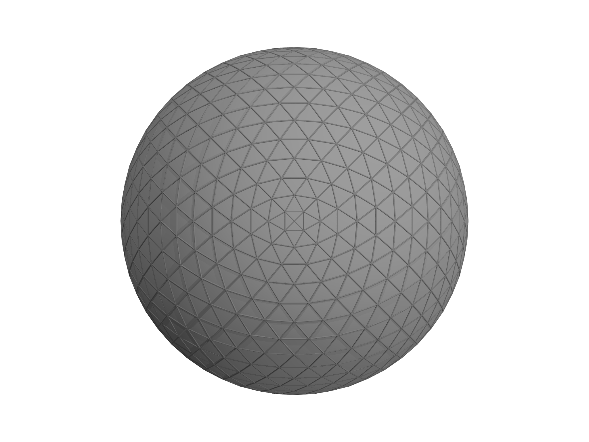

Morpho
======

|build-status| |test-status| |cite|

.. |build-status| image:: https://github.com/Morpho-lang/morpho/actions/workflows/build.yml/badge.svg
   :alt: Build
   :target: https://github.com/Morpho-lang/morpho/actions/workflows/build.yml

.. |test-status| image:: https://github.com/Morpho-lang/morpho/actions/workflows/buildandtest.yml/badge.svg
   :alt: Test suite
   :target: https://github.com/Morpho-lang/morpho/actions/workflows/buildandtest.yml

.. |cite| image:: https://img.shields.io/badge/cite-10.1038%2Fs43588--024--00749--7-blue
   :alt: Cite: A programmable environment for shape optimization and shapeshifting problems
   :target: https://doi.org/10.1038/s43588-024-00749-7

Morpho is a programmable environment for shape optimization and scientific
computing. It combines familiar C-family syntax, object-oriented programming,
and high-performance numerical libraries to help you explore and solve
computational problems.

Morpho is designed to be:

* **Familiar:** a compact syntax that is easy to learn.
* **Fast:** numerical computing powered by libraries such as BLAS, LAPACK,
  and SuiteSparse.
* **Extensible:** add functionality through packages written in Morpho,
  C, or other compiled languages.

The Morpho ecosystem
--------------------

Morpho combines a core language with tools and optional packages for scientific
computing, visualization, and integration with other software:

* `morpho-cli <https://github.com/Morpho-lang/morpho-cli>`_ provides the
  command-line interface for running scripts and working interactively.
* `morphoview <https://github.com/Morpho-lang/morpho-morphoview>`_ is the
  viewer application for displaying geometry and graphics created with Morpho.
* `morphopm <https://github.com/Morpho-lang/morpho-morphopm>`_ is the package
  manager for downloading, installing, and distributing additional packages.

Extensions connect Morpho to **POV-Ray** for ray-traced rendering, **VTK** for
scientific visualization workflows, and **ZeroMQ** for messaging between
applications. These integrations let you extend Morpho beyond the core language
and connect it to your existing tools.

Getting started
---------------

* `Install Morpho <https://github.com/Morpho-lang/morpho#installation>`_
  to set up the language, terminal application, and supporting tools.
* Watch the `introduction to the Morpho language
  <https://youtu.be/eVPGWpNDeq4>`_ or the `shape optimization tutorial
  <https://youtu.be/odCkR0PDKa0>`_.
* Read the `user manual
  <https://github.com/Morpho-lang/morpho-manual/blob/main/manual.pdf>`_
  for a more extensive guide.

Example: minimizing surface area
--------------------------------

This program solves a toy shape-optimization problem: minimizing the area of a
closed surface at constant volume. It constructs a mesh, defines a constrained
shape-optimization problem, chooses an optimization algorithm, alternates
optimization with mesh refinement, and visualizes the results.

The script defines an ``OptimizationProblem`` with an ``Area`` energy and a
``VolumeEnclosed`` constraint. A ``ProblemAdapter`` connects the problem to an
``SQPController``, which optimizes the shape at each refinement level.

.. code-block:: morpho

   import meshtools, optimize4, morphoview, plot

   var m = cube() // Create the mesh
   var problem = OptimizationProblem(m)
    problem.addenergy(Area())
    problem.addconstraint(VolumeEnclosed())
    var adapt = ProblemAdapter(problem, m)
    var opt = SQPController(adapt)

    for (level in 1..4) {
      opt.optimize(100)
      if (level == 4) break
      var refmap = MeshRefiner([m]).refine()
      problem.update(refmap)
      m = refmap[m] // use the refined mesh
      adapt = ProblemAdapter(problem, m)
      opt = SQPController(adapt)
    }

    Show(Plot(m, grade=[1,2], style=["thick", "shaded"], title="Minimizing Surface Area"))

After each refinement, the problem is updated using the refinement map, and
the adapter and optimizer are recreated for the refined mesh. Finally,
``Show(Plot(...))`` displays the optimized mesh. This example requires
``meshtools``, ``optimize4``, ``morphoview``, and ``plot``.

Explore the reference
---------------------

Learn the language with the references for :doc:`syntax`, :doc:`values`,
and :doc:`functions`. For shape optimization, explore :doc:`mesh`,
:doc:`functionals`, and :doc:`optimize`.

Community and contributions
---------------------------

Morpho is under active development and welcomes contributions. See the
`contributor's guide
<https://github.com/Morpho-lang/morpho/blob/main/CONTRIBUTING.md>`_
for ways to get involved, or use `GitHub Issues
<https://github.com/Morpho-lang/morpho/issues>`_ to report bugs and suggest
improvements.

.. toctree::
   :hidden:
   :caption: Language
   :maxdepth: 1

   syntax
   values
   variables
   controlflow
   functions
   classes
   modules
   help
   builtin

.. toctree::
   :hidden:
   :caption: Data Types
   :maxdepth: 1

   array
   complex
   dictionary
   list
   matrix
   range
   sparse
   string
   tuple

.. toctree::
   :hidden:
   :caption: Computational Geometry
   :maxdepth: 1

   field
   fespace
   functionals
   mesh
   selection

.. toctree::
   :hidden:
   :caption: I/O
   :maxdepth: 1

   file
   system
   json

.. toctree::
   :hidden:
   :caption: Modules
   :maxdepth: 1

   color
   constants
   delaunay
   graphics
   implicitmesh
   kdtree
   meshgen
   meshslice
   meshtools
   optimize
   plot

.. toctree::
   :hidden:
   :caption: Error messages
   :maxdepth: 1

   errors
